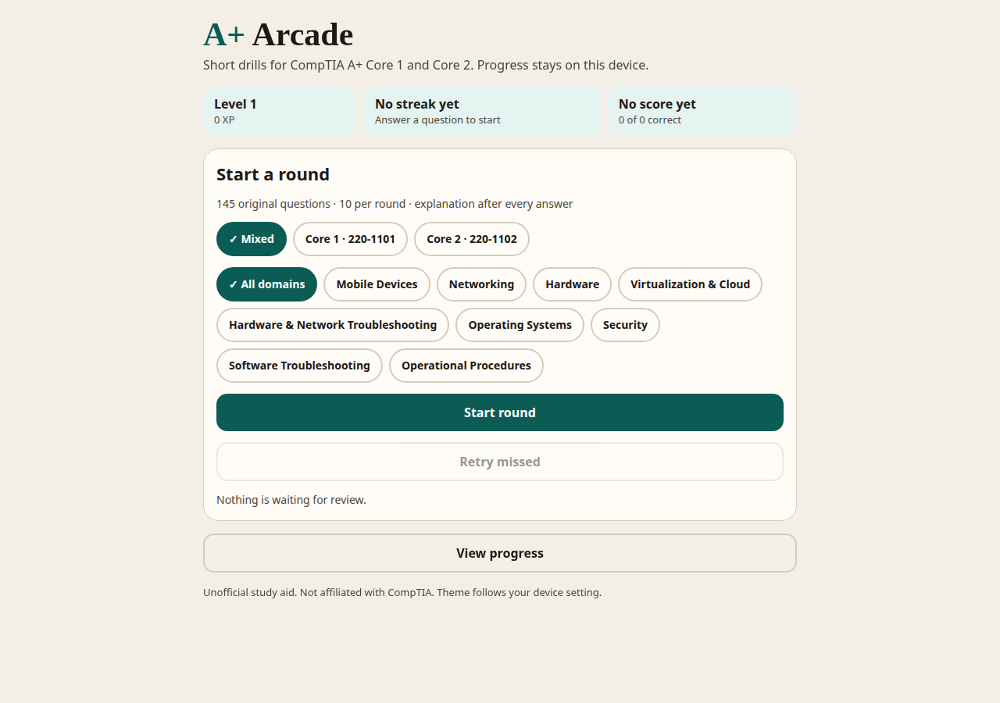
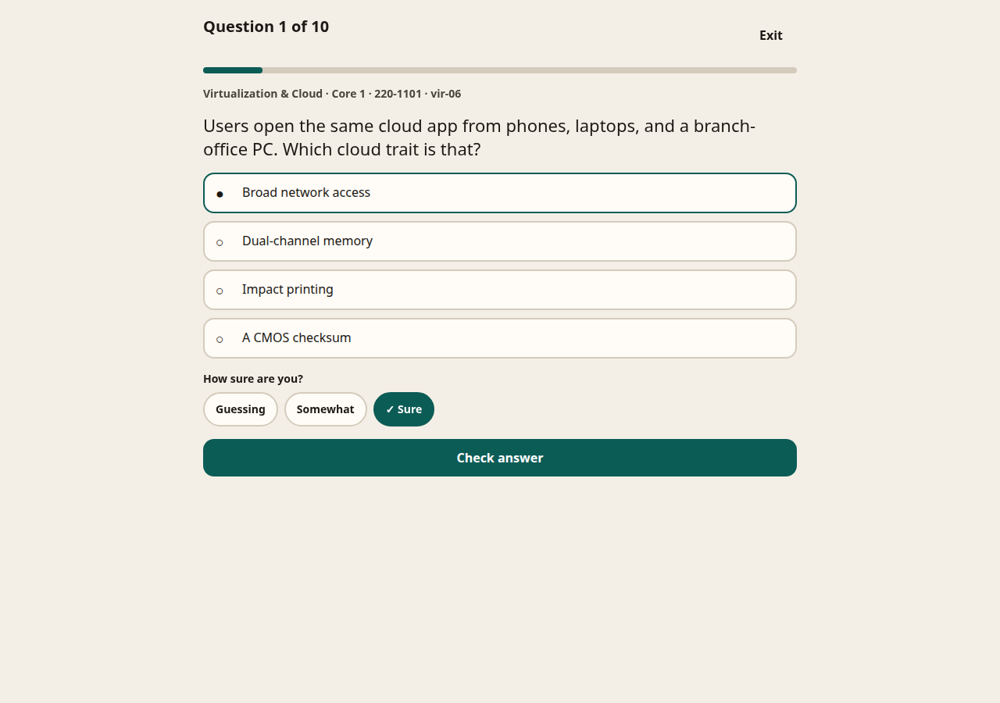
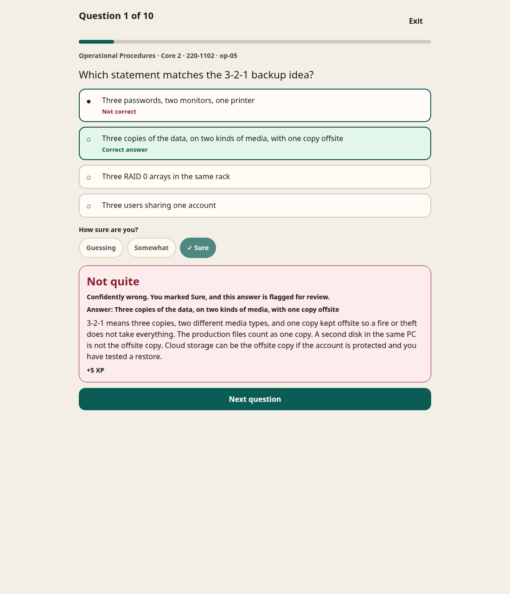
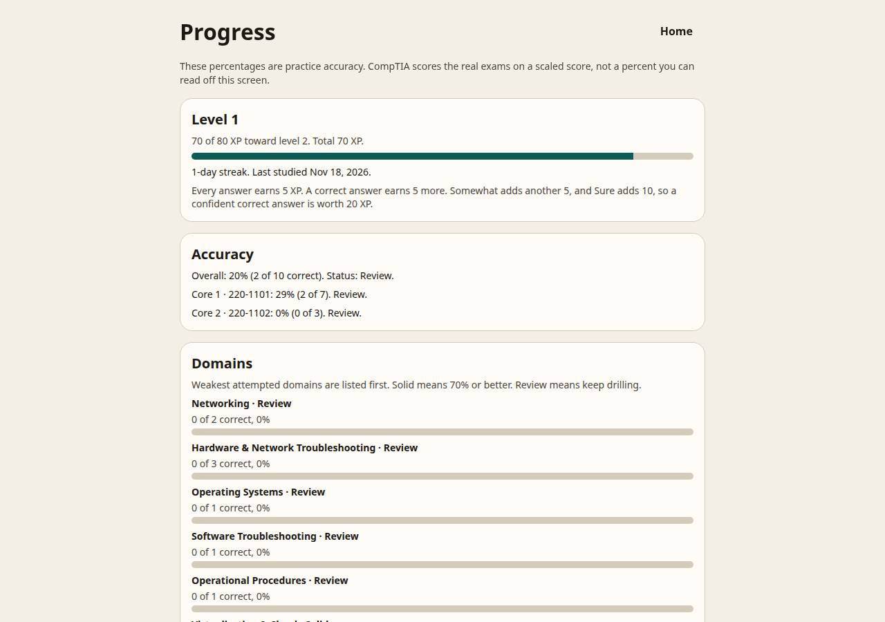
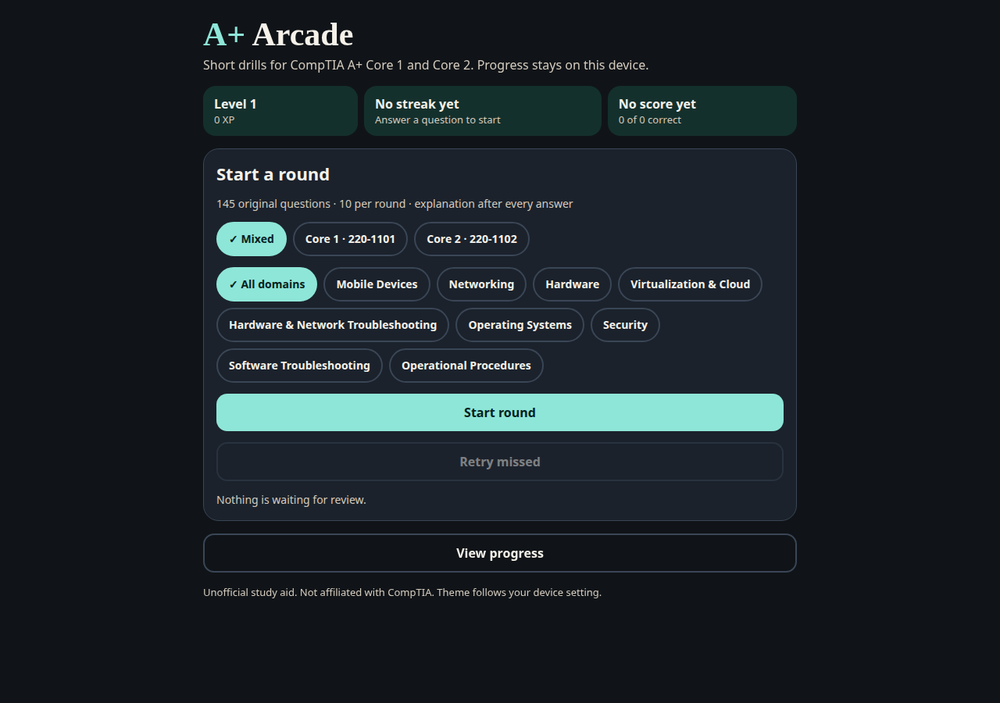

# A+ Arcade

[](https://github.com/Mercury101999/aplus-arcade/actions/workflows/ci.yml)
[](https://mercury101999.github.io/aplus-arcade/)
[](LICENSE)

**A+ Arcade** is a small study app for the CompTIA A+ Core 1 (220-1101) and Core 2 (220-1102) exams. It runs short quiz rounds, shows the explanation immediately, and keeps score on the device. There is no account and no server.

Live demo: [https://mercury101999.github.io/aplus-arcade/](https://mercury101999.github.io/aplus-arcade/)

I built it as a portfolio piece while preparing for help-desk interviews: the same kind of troubleshooting the exams ask about, practiced in ten-question shifts.

## Screenshots

| Home | Confidence check |
| --- | --- |
|  |  |

| Explanation | Progress |
| --- | --- |
|  |  |



The theme follows the device setting. Dark mode is the same layout with the dark palette.

## Features

- **145 original questions** across the nine official domains (at least 16 each). Every item has one or more correct choices and a short explanation. These are not copied from a commercial bank.
- **10-question rounds** filtered by exam, by domain, or mixed.
- **Instant feedback** with the correct answer and the explanation.
- **Confidence check** before the result: Guessing, Somewhat, or Sure. The progress screen compares those ratings with what actually happened and calls out answers that were marked Sure and missed.
- **Retry missed.** A wrong answer, or a correct answer you only guessed, goes into a review queue. A question leaves the queue after a correct answer you were willing to stand behind (Somewhat or Sure).
- **A light arcade layer:** XP, levels, a daily streak, and badges. Correct and confident answers are worth more. Motion is skipped when the device asks for reduced motion.
- **Progress** by exam and domain, weakest domains first, plus a reset that asks you to confirm.
- **On-device storage** with AsyncStorage, including web. Nothing is sent to a backend.

## Tech stack

- Expo SDK 58, Expo Router, and TypeScript in strict mode
- React Native, so the same UI targets iOS, Android, and web
- AsyncStorage for progress
- Jest and React Native Testing Library
- ESLint (`eslint-config-expo`)
- GitHub Actions for typecheck, lint, and tests
- A second workflow exports the web build and deploys it to GitHub Pages at `/aplus-arcade/`

## Architecture

The rules of the game do not live in the screens. That keeps them easy to test and hard to drift.

- `src/content` is the typed question bank. A validator checks unique ids, in-range answers, explanations, and that every domain is covered.
- `src/game` is pure TypeScript: round selection, XP, streaks, the review queue, levels, and badges. It does not import React.
- `src/storage` reads and writes that state through AsyncStorage and drops anything it cannot parse.
- `src/screens` and `src/components` render the home, quiz, and progress flows. Routes in `src/app` only connect those screens to Expo Router.
- `src/theme` holds the light and dark palettes. A test checks the text pairs against WCAG AA contrast.

A round is 10 questions. Each answer is worth 5 XP. A correct answer adds 5, Somewhat adds another 5, and Sure adds 10, so a confident correct answer is 20 XP. The streak counts calendar days on the device, not a server clock.

## Run it

Node.js 22 or newer.

```bash
npm install
npm run web      # web
npm start        # then press i or a for a simulator, or scan the QR code with Expo Go
npm run ios
npm run android
```

The web export and the dev server both use the base path `/aplus-arcade`, which is what GitHub Pages needs for a project site. Open the URL Expo prints. It includes that path.

```bash
npm test
npm run typecheck
npm run lint
npm run export:web
npm run pages:prepare
```

To preview the production web build the way Pages serves it:

```bash
npm run export:web
npm run pages:prepare
mkdir -p /tmp/gh-pages/aplus-arcade
cp -a dist/. /tmp/gh-pages/aplus-arcade/
npx serve /tmp/gh-pages
```

Then open `http://127.0.0.1:3000/aplus-arcade/`.

## Tests

`npm test` runs 25 tests:

- the whole question bank (unique ids, valid answers, explanations, every domain)
- round filters, the retry queue, and multi-select grading
- XP, streaks, levels, badges, and corrupt save data
- contrast of both themes
- the home screen, a quiz round through the explanation, and the progress screen including reset confirmation

## What I learned

The interesting part was not the questions. It was keeping the scoring honest. A confidence rating is useless if it is collected after the answer is revealed, and a review queue that never lets a question go becomes a junk drawer. Writing those rules as plain functions, then driving the screens from the result, made the edge cases (a correct guess, a confident miss, a skipped day) easy to pin down with tests.

Shipping the same project to a phone and to GitHub Pages forced the storage and the router to be boring on purpose. AsyncStorage is the whole backend. The web build has to load scripts from `/aplus-arcade/`, and GitHub Pages needs a real `index.html` for each route plus a `.nojekyll` file because the bundle lives under `_expo`. Getting that path right mattered more than adding another feature.

I also treated contrast and focus as part of the build, not a pass at the end. The palette test fails if body text drops under 4.5:1, and the web CSS draws a visible focus ring. Color is paired with words like Correct, Not quite, Solid, and Review.

## Disclaimer

A+ Arcade is an unofficial study aid. CompTIA, A+, and the exam titles Core 1 (220-1101) and Core 2 (220-1102) are trademarks of CompTIA, Inc. This project is not affiliated with, endorsed by, or sponsored by CompTIA. The questions were written for this repository. They are practice, not a prediction of an exam score, and not a dump of real exam items.

## License

[MIT](LICENSE) © 2026 Jack Powell
